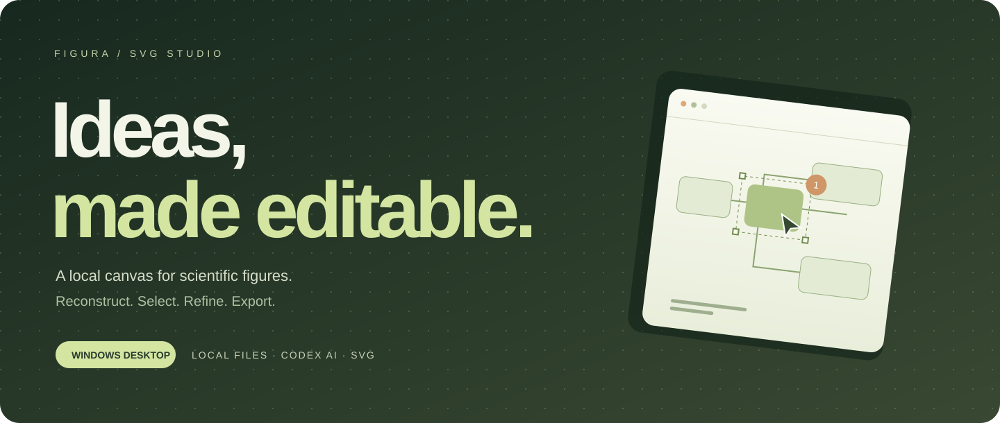
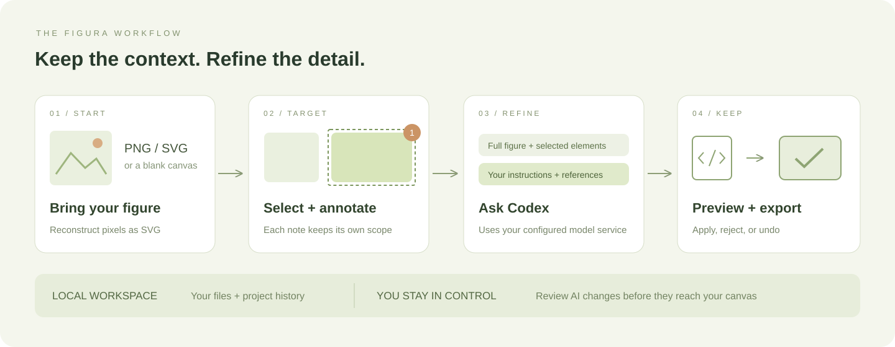
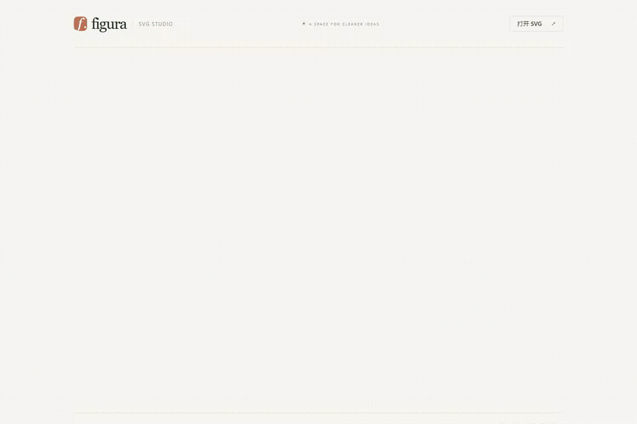
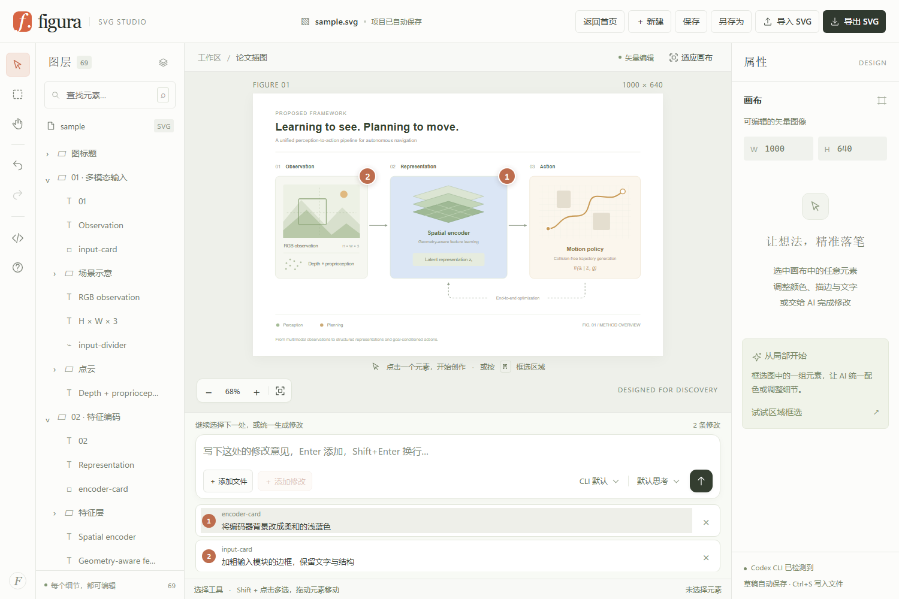
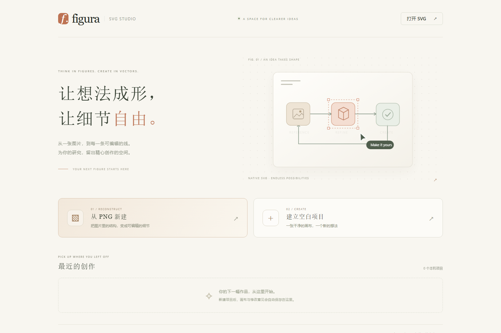

<div align="center">



### 让论文插图的每一个细节，都可以被精心修改。

本地 SVG 工作室 · PNG 矢量重绘 · 选区 AI 修改 · 多处意见统一生成

[](https://github.com/sbdyl/svg-ai-editor/releases/latest)
[](https://github.com/sbdyl/svg-ai-editor/releases/latest)
[](public/sample.svg)

[**下载桌面版**](https://github.com/sbdyl/svg-ai-editor/releases/latest) · [**观看介绍视频**](docs/media/figura-demo.mp4) · [**完整使用指南**](docs/guide.zh-CN.md) · [**反馈问题**](https://github.com/sbdyl/svg-ai-editor/issues)

</div>

---

## 从“生成一张图”，到“改好每一处”

Figura 面向论文插图、方法框架图和技术示意图。你可以从 PNG 重建可编辑的 SVG，也可以直接打开已有的矢量图，在图层中选择对象、调整样式，并把修改要求留在具体位置。

**选中哪里，就修改哪里。** AI 获得完整图形作为上下文，返回选中元素的替换结果。你先查看预览，再决定应用或放弃；应用后仍然可以撤销。



## 看它工作

[](docs/media/figura-demo.mp4)

**[▶ 查看完整介绍视频](docs/media/figura-demo.mp4)** · **[下载 MP4](https://github.com/sbdyl/svg-ai-editor/releases/download/v1.0.0/figura-demo.mp4)**

动态预览可直接在本页观看；完整 MP4 可从 Release 下载，或在视频文件页面点击「View raw」取得。

真实界面录制：打开 SVG → 调整颜色与撤销 → 在两处选区添加意见 → 导出 SVG → 从历史项目继续。视频展示 AI 请求前的标注准备，未调用模型，也未用模拟结果冒充 AI 生成。

<details>
<summary><strong>展开查看工作区与欢迎页</strong></summary>





</details>

## 为细节而设计

| 能力 | 用它完成什么 |
| :--- | :--- |
| **从 PNG 重建** | 把文字、框线、箭头和主体结构重绘为 SVG；在预览中对照原图，隐藏位图检查矢量结构。 |
| **选区 AI 修改** | 选择元素或框选区域，描述改动；前后端校验范围，确认预览后再应用。 |
| **多处意见** | 给不同位置留下编号标注，一次发送多条要求，每条保留自己的目标范围。 |
| **参考材料** | 添加 PDF、Word、文本与图片；PDF 支持指定页码，文档与图片可作为生成上下文。 |
| **直接编辑** | 调整填充、描边、透明度、文字与字号；移动对象、展开编组、撤销和重做。 |
| **本地项目** | 欢迎页管理独立项目与缩略图，自动保存草稿，用 `Ctrl+S` 写回磁盘。 |
| **标准 SVG 输出** | 导出整张图或独立选区，保留矢量结构，继续用于论文和其他设计工具。 |

## 下载，打开，开始创作

前往 **[最新 Release](https://github.com/sbdyl/svg-ai-editor/releases/latest)**，选择适合自己的版本：

| 文件 | 适用场景 |
| :--- | :--- |
| `Figura-SVG-Studio-1.0.0-x64-Setup.exe` | 安装到电脑，创建桌面和开始菜单快捷方式。 |
| `Figura-SVG-Studio-1.0.0-x64-Portable.exe` | 免安装启动；项目历史仍保存在当前 Windows 用户目录。 |
| `SHA256SUMS.txt` | 核对下载文件的 SHA-256 校验值。 |

**Windows 10 / 11，64 位。** 编辑器自带运行环境，基础编辑无需单独安装 Node.js。当前发布未进行代码签名，Windows 可能显示未知发布者提示。

1. 启动 Figura，在欢迎页选择「打开 SVG」「从 PNG 新建」或「建立空白项目」。
2. 用左侧图层或画布选中对象，直接修改属性，或在底部添加修改意见。
3. 查看 AI 预览后应用修改，点击「保存」写入文件，或点击「导出 SVG」取得完整矢量图。

> 新建项目默认保存到 Windows「文档」下的 `Figura` 文件夹。草稿自动保存与磁盘保存分别进行；交付文件时请保存或导出。桌面版与浏览器版的项目历史分别存储，可用 SVG 文件互相交换。

### 启用 AI

AI 功能使用你本机的 **Codex CLI** 与已有认证。若尚未配置，先安装 Node.js，然后在终端执行：

```powershell
npm install -g @openai/codex
codex login
```

完成后重新启动 Figura。你可以沿用 CLI 默认模型，也可以在编辑器中选择本机缓存列出的模型和思考强度。PNG 重绘及包含图像的参考材料需要支持图片输入的模型。

CLI 不在 `PATH` 时，将 `CODEX_BIN` 指向 `codex.exe` 或 `@openai/codex/bin/codex.js`。完整说明见 [Codex 配置与使用指南](docs/guide.zh-CN.md#codex-cli)。

### 常用快捷键

| 操作 | 快捷键 |
| :--- | :--- |
| 选择 / 框选 / 平移 | `V` / `M` / `H`，或按住空格平移 |
| 多选 | `Shift` + 点击 |
| 添加一条修改 / 输入换行 | `Enter` / `Shift+Enter` |
| 发送 AI 修改 | `Ctrl+Enter` |
| 保存 / 另存为 | `Ctrl+S` / `Ctrl+Shift+S` |
| 撤销 / 重做 | `Ctrl+Z` / `Ctrl+Shift+Z` |

## 数据与边界，讲清楚

- **编辑工作区在本机。** 桌面服务仅监听 `127.0.0.1`，默认端口 `14317`。项目草稿保存在应用数据目录，SVG 保存到你选择的位置。
- **AI 会使用模型服务。** 完整 SVG、修改要求及选用的参考材料会通过 Codex 发送到你配置的模型服务；AI 功能不是离线推理。
- **重绘需要复核。** PNG 重建不是像素级无损转换。请检查文字、连线和科学含义；局部图标可能保留为内嵌位图。
- **保留可编辑结构。** 已转曲的文字不会自动变回文本；脚本、动画和外部资源会在导入时移除。
- **附件属于本次会话。** 原始 PNG 和参考附件在刷新或重启后需重新添加；已应用到 SVG 的内容随项目保存。

具体格式、尺寸限制、保存冲突处理和使用说明见 [完整指南](docs/guide.zh-CN.md)。

## 从源码运行

使用 Node.js **22.13 或更新版本**：

```powershell
git clone https://github.com/sbdyl/svg-ai-editor.git
cd svg-ai-editor
npm ci
npm run desktop
```

浏览器模式：`npm start`，然后打开 `http://127.0.0.1:4317`。

```powershell
# 检查编辑器与本地服务
npx playwright install chromium
npm test

# 检查桌面窗口、PDF 解析、文件保存与重启恢复
npm run test:desktop

# 构建 Windows x64 安装版与免安装版
npm run dist:win
```

构建结果位于 `release/`。桌面检查使用独立临时项目和 CLI 测试替身，不消耗真实模型请求。发布流程与验证范围见 [发布说明](docs/releasing.md)。

<div align="center">

---

**FIGURA / MADE FOR DISCOVERY**

把精力留给想法，把细节打磨到位。

[下载](https://github.com/sbdyl/svg-ai-editor/releases/latest) · [指南](docs/guide.zh-CN.md) · [问题反馈](https://github.com/sbdyl/svg-ai-editor/issues)

</div>
